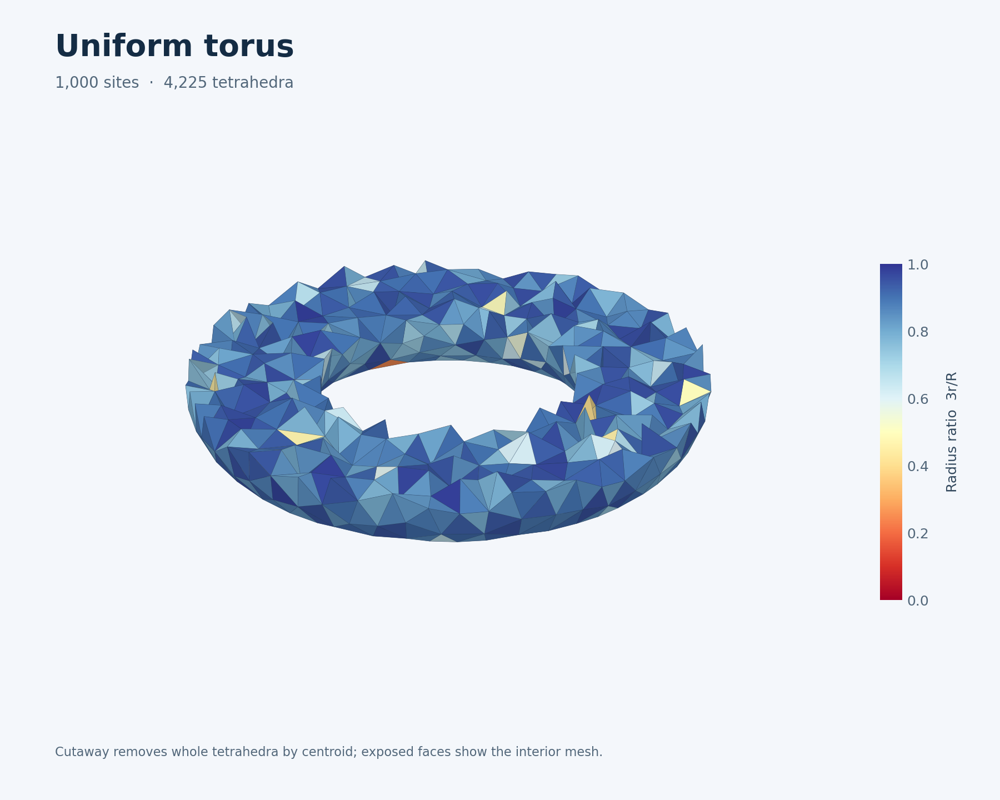
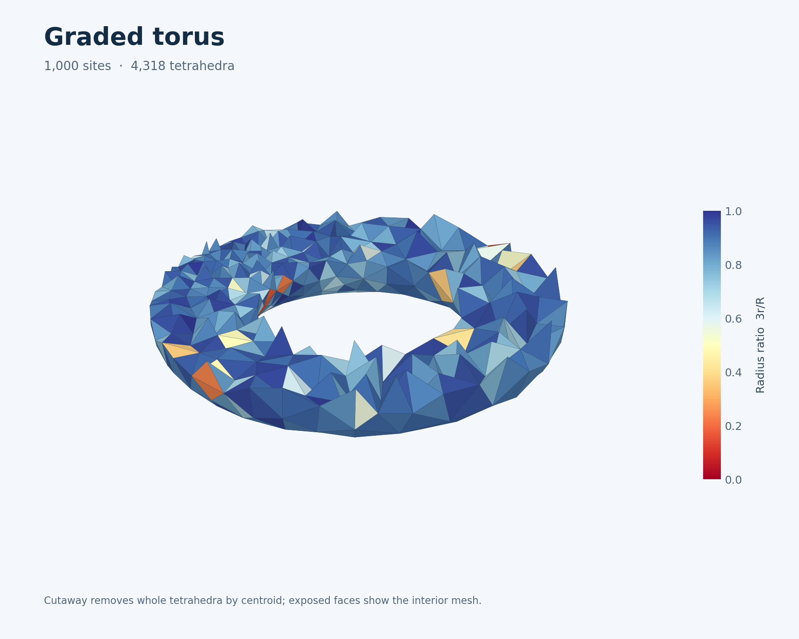
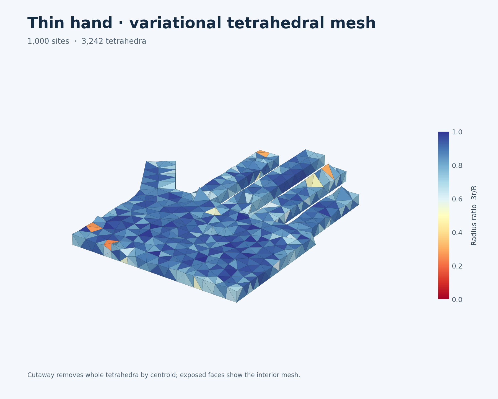
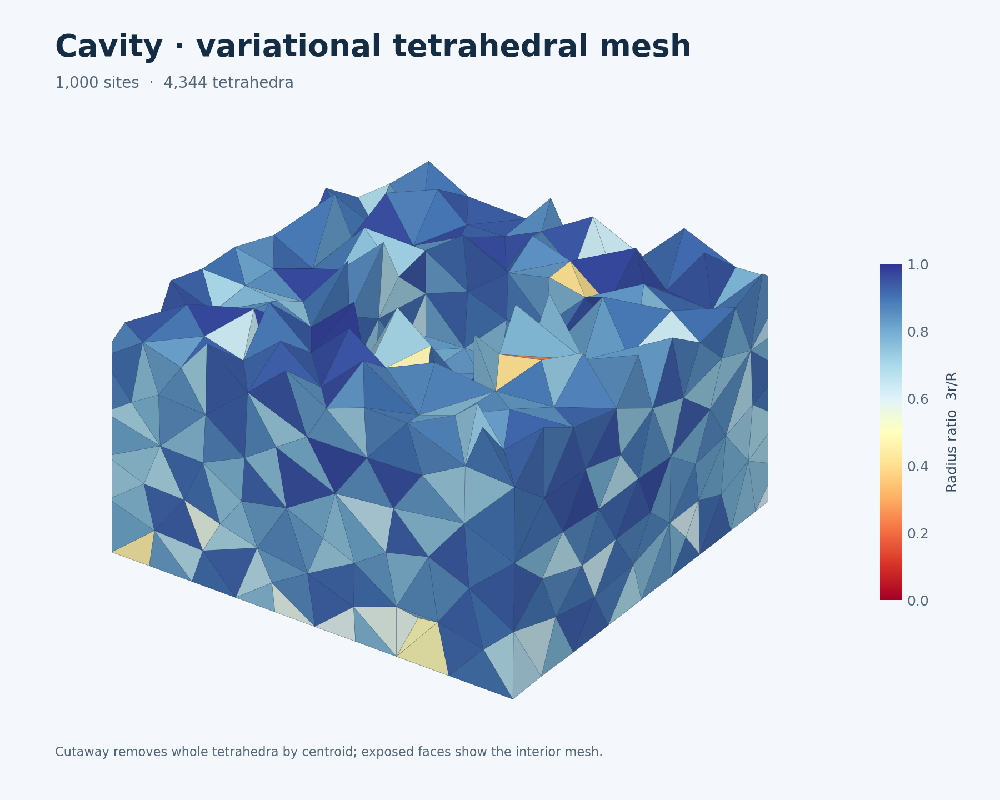
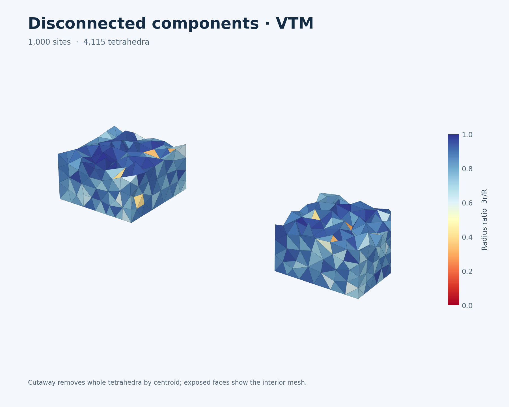

# Reproducible full-mesher examples

The gallery runner supplies fixed inputs, runs the complete public device
pipeline, and exports an inspectable tetrahedral mesh. Surface generation or OFF
loading happens before meshing. Each captured replay includes domain and optional
sizing refits, fresh sampling, progressive fitting/refinement, quality improvement
and extraction. Host readback, independent checking and file export happen after
replay. The examples do not add a CPU geometry fallback to the mesher.

From a source checkout:

```bash
pip install -e '.[dev,bench]'
python -m examples.vtm_gallery --case torus --n 1000 --output results/local/torus
python -m examples.vtm_gallery --case graded-torus --n 1000 --output results/local/graded-torus
python -m examples.vtm_gallery --case thin-hand --n 1000 --output results/local/thin-hand
python -m examples.vtm_gallery --case cavity --n 1000 --output results/local/cavity
python -m examples.vtm_gallery --case disconnected --n 1000 --output results/local/disconnected
```

The uniform and prescribed-graded torus, thin hand, cavity and separated
components have completed full solves with independent quality and topology
checks. The broader gallery, including imported scanned geometry, remains
tracked in [issue #39](https://github.com/alecjacobson/warpower/issues/39).

The thin hand is a new extruded palm with five narrow fingers and sharp corners,
not the scanned hand from Alliez et al. The torus tests nonconvex topology;
the cavity and separated components exercise material orientation and extraction.
The graded torus uses a prescribed relative sizing field, ranging from 0.35 near
the leftmost side to at most 1 elsewhere. The field's min-cone extension is
computed on device. `--automatic-sizing` on an ungraded case instead selects
the mesher's pole-based local-feature-size path.

Import an already closed, oriented triangular surface without changing its
geometry:

```bash
python -m examples.vtm_gallery --case surface --input model.off --n 2000 --output results/local/model
python -m examples.vtm_gallery --case graded-surface --input model.off --n 2000 --output results/local/graded-model
```

Input positions are converted to float32, matching the mesher's API. The exported
`input.off` writes those float32 values with 17 significant decimal digits so
native CPU comparisons can receive the same coordinates. Imported assets retain
their own provenance and licensing; this runner bundles no third-party model.

Each successful run writes:

- `result.json`: settings, seed, input hash, hardware, setup/first-replay times,
  additional replay samples, CPU quota observations, topology and quality.
- `input.off` and `boundary.off`: original input and extracted surface.
- `mesh.npz`: points, material/full-hull tetrahedra, boundary faces, roles and
  radius ratios, together with the input surface.
- `mesh.vtu`: a portable VTK tetrahedral mesh with a `radius_ratio` cell field.
  Open it in a mesh viewer and use a clipping plane to inspect interior elements.

Use `--repeats 5` for five additional complete resident-device solves. Initial
setup and the first solve are reported separately. This is not a CPU speedup
measurement. `--independent-quality` adds NumPy tetrahedron solves, incidence
checks, dihedral angles and two-sided area-weighted boundary RMS against all
input triangles. That brute-force validation may be slow on large surfaces; it
is excluded from replay timing. Boundary RMS uses three quadrature samples per
triangle and is not a Hausdorff bound. Invalid solves save diagnostics and do not
export an empty mesh as a successful result.

Create a static cutaway preview from an exported mesh:

```bash
python -m examples.vtm_render results/local/torus/mesh.npz --output results/local/torus/cutaway.png
```

The preview removes whole tetrahedra according to their centroid coordinate;
it is not a geometric clipping operation on the saved mesh. Face colors show
radius ratio with directional lighting. Mesh generation and export do not
require the renderer.


## Published torus results

Both examples start from the same 1,152-vertex, 2,304-triangle torus and produce
1,000 sites, using seed 2026, 256 initial sites and four quality rounds. They
preserve one material component and a closed boundary of Euler characteristic
zero. Independent NumPy calculations found all tetrahedra positively oriented
and reproduced the device radius ratios. VTU round trips reproduce the NPZ
coordinates, connectivity and quality values exactly.

| Measurement | Uniform | Prescribed grading |
| --- | ---: | ---: |
| Material tetrahedra | 4,225 | 4,318 |
| Boundary triangles | 1,122 | 1,062 |
| Minimum radius ratio, 3r/R | 0.09286 | 0.09825 |
| Median radius ratio | 0.87442 | 0.87460 |
| Minimum / maximum dihedral angle | 3.06° / 171.81° | 5.03° / 171.82° |
| Two-sided sampled boundary RMS / box diagonal | 0.2562% | 0.3910% |
| Relative volume error | −5.09% | −7.15% |
| Complete resident solve, median of 3 additional replays | 3.637 s | 6.659 s |
| First complete replay | 3.754 s | 6.766 s |

Timings use an NVIDIA L40 and Warp 1.19.0 at runtime commit `c0b3258`.
All measured windows had zero observed CPU quota throttling. They include fresh
sampling and the complete captured pipeline. They are historical measurements,
not promises for later versions or a CPU speedup result. The native CPU baseline
currently runs faster; see [the full-mesher comparison](cpu-mesher-baseline.md).
The boundary metric is sampled RMS, not a maximum-distance guarantee. Neither
example is claimed to meet a prescribed minimum element-quality threshold.

The grading changes the allocation of sites substantially. In the regions
`x < -1` and `x > 1`, respectively, the uniform mesh has 351 / 319 sites and
median nearest-site distances 0.275 / 0.282. The graded mesh has 665 / 129 sites
and distances 0.204 / 0.404. Median tetrahedron volumes in those regions change
from 0.00412 / 0.00445 to 0.00173 / 0.01199. At the same site budget, the finer
left side comes with a coarser right side and greater total boundary-fit error.

| Uniform | Prescribed grading |
| --- | --- |
|  |  |

These are centroid cutaways colored by radius ratio. Download the
[uniform mesh](../results/examples/vtm/torus/mesh.vtu) or
[graded mesh](../results/examples/vtm/graded-torus/mesh.vtu) for geometric
inspection. Each result directory also contains the input/output OFF surfaces,
NPZ arrays and raw timing/quality JSON. The
[provenance manifest](../results/examples/vtm/provenance.json) records runner
revisions and artifact hashes; the
[grading/export check](../results/examples/vtm/grading-and-export-check.json)
records the regional measurements and VTU round trip.

Reproduce the measured configurations with:

```bash
python -m examples.vtm_gallery --case torus --n 1000 --repeats 3 --independent-quality --output results/local/torus
python -m examples.vtm_gallery --case graded-torus --n 1000 --repeats 3 --independent-quality --output results/local/graded-torus
```

## Published thin-hand result

The procedural hand has 46 input vertices, 88 triangles, a thin palm and five
sharp-edged fingers. It exercises thin geometry and feature fitting inspired by
the paper; it is not a reproduction of the paper's scanned hand. The example
starts with 256 sites and reaches 1,000 sites after four growth rounds. Two
extraction-recovery rounds and four quality rounds produce a connected material
mesh with one closed boundary, no cavity and Euler characteristic two.

| Measurement | Thin hand |
| --- | ---: |
| Full-hull / material tetrahedra | 5,529 / 3,242 |
| Boundary triangles | 1,626 |
| Minimum / mean / median radius ratio, 3r/R | 0.09352 / 0.82145 / 0.85435 |
| First percentile radius ratio | 0.32500 |
| Minimum / maximum dihedral angle | 4.62° / 172.21° |
| Two-sided sampled boundary RMS / box diagonal | 0.03446% |
| Relative volume error | +0.1161% |
| Complete resident solve, median of 3 additional replays | 16.275 s |
| First complete replay | 16.419 s |
| Setup, including graph construction | 1.140 s |

These measurements use an NVIDIA L40, Warp 1.19.0 and runtime commit `cf35509`.
The later [fragment-reuse optimization](delaunay-reuse.md) reduces the same
complete hand solve to 3.366 s; the original gallery artifacts below retain their
historical timing and provenance.
Four complete captured executions finished, with zero observed CPU quota
throttling in setup or timing windows. The saved final mesh passes independent
NumPy quality/incidence checks. CGAL 6.2.1 exact predicates additionally check
every full-hull cell's original-coordinate orientation and empty circumsphere,
face pairing, and hull support against every site. The VTU round trip exactly
reproduces the NPZ coordinates, connectivity and quality. CGAL and NumPy run
offline after GPU timing; they are not runtime dependencies or CPU fallbacks.
These results do not establish a CPU speedup, a prescribed minimum quality of
0.3, or a maximum boundary-distance guarantee.



Download the [material mesh](../results/examples/vtm/thin-hand/mesh.vtu),
[full array export](../results/examples/vtm/thin-hand/mesh.npz),
[raw measurements](../results/examples/vtm/thin-hand/result.json) and
[independent check record](../results/examples/vtm/thin-hand/export-and-native-check.json).
Input/output surfaces and hashes are also included in the gallery and its
[provenance manifest](../results/examples/vtm/provenance.json).

The thin-hand, cavity and disconnected runners default to surface and crease
subdivisions **20/20**; other examples retain **4/4**, and explicit arguments
override either default.
This increases quadrature density without subdividing the input geometry.
It reserves 105,600 surface samples and 10,560 crease-sample slots. On the same
runtime and 1,000-site target, both 4/4 and 20/4 fail material-boundary validation
and publish zero mesh counts. Increasing surface sampling alone is insufficient.
The [coarse diagnostic records](../results/examples/vtm/thin-hand/coarse-comparison.json)
retain those failures; their times are not comparable clean benchmark samples.
General coarse-boundary recovery remains open in
[issue #112](https://github.com/alecjacobson/warpower/issues/112), and representable
boundary updates in [issue #117](https://github.com/alecjacobson/warpower/issues/117).

Reproduce the measured configuration and preview with:

```bash
python -m examples.vtm_gallery --case thin-hand --n 1000 --subdivisions 20 --crease-subdivisions 20 --repeats 3 --independent-quality --output results/local/thin-hand
python -m examples.vtm_render results/local/thin-hand/mesh.npz --axis z --fraction 0.5 --title 'Thin hand · variational tetrahedral mesh' --output results/local/thin-hand/cutaway.png
```

## Published cavity and disconnected results

These two inputs each have 16 vertices and 24 triangles. The cavity is an outer
cube with a reversed inner shell; the disconnected case has two separated
cubes. Both use 1,000 sites, 256 initial sites, seed 2026 and quadrature 20/20.
Four growth rounds and four quality rounds complete without extraction recovery.
The cavity produces one material component, two closed shells and one cavity;
the separated cubes produce two material components and two closed shells.
Each boundary shell has Euler characteristic two.

| Measurement | Cavity | Disconnected |
| --- | ---: | ---: |
| Full-hull / material tetrahedra | 5,064 / 4,344 | 5,768 / 4,115 |
| Boundary triangles | 1,124 | 1,166 |
| Minimum / mean radius ratio, 3r/R | 0.23681 / 0.84004 | 0.08111 / 0.83711 |
| First percentile / median radius ratio | 0.40641 / 0.87128 | 0.34898 / 0.86943 |
| Minimum / maximum dihedral angle | 10.18° / 161.18° | 3.86° / 173.36° |
| Two-sided sampled boundary RMS / box diagonal | 0.16778% | 0.01984% |
| Relative volume error | +0.25498% | −0.06253% |
| Complete resident solve, median of 3 additional replays | 1.417 s | 1.240 s |
| First complete replay | 1.580 s | 1.480 s |
| Setup, including graph construction | 1.124 s | 1.121 s |

These measurements use an NVIDIA L40, Warp 1.19.0, runtime `1804b64` and runner
`e01e9d2`. Setup and replay windows have zero observed CPU quota throttling.
Independent CGAL exact predicates check every full-hull cell against every
site, with face pairing and hull support. Independent NumPy checks measure
material quality, topology and two-sided fit. VTU round trips reproduce the
saved mesh exactly. These offline checks are excluded from GPU timings and
are not runtime dependencies. The results do not establish CPU outperformance,
convergence, a prescribed minimum quality or a maximum-distance bound.

| Cavity | Disconnected components |
| --- | --- |
|  |  |

Download the [cavity mesh](../results/examples/vtm/cavity/mesh.vtu) or
[disconnected mesh](../results/examples/vtm/disconnected/mesh.vtu). Their
directories contain source surfaces, NPZ arrays, raw timings and independent
checks; the [manifest](../results/examples/vtm/provenance.json) records hashes.

Sampling matters. The coarse 4/4 cavity still fails the material-boundary gate
with one nonmanifold edge and zero public output counts; recovery remains
tracked in [#125](https://github.com/alecjacobson/warpower/issues/125).
The coarse 4/4 disconnected case now succeeds after
[stable geometry evaluation](extraction-geometry.md), but takes 11.743 s and
has minimum radius ratio 0.06904 and sampled RMS error 0.33674% of the box
diagonal. The dense example improves those measurements. Coarse records are
included as `coarse-comparison.json`; the failed cavity is not a successful
mesh or a comparable timing sample.

Reproduce the measured configurations with:

```bash
python -m examples.vtm_gallery --case cavity --n 1000 --subdivisions 20 --crease-subdivisions 20 --repeats 3 --independent-quality --output results/local/cavity
python -m examples.vtm_gallery --case disconnected --n 1000 --subdivisions 20 --crease-subdivisions 20 --repeats 3 --independent-quality --output results/local/disconnected
```
