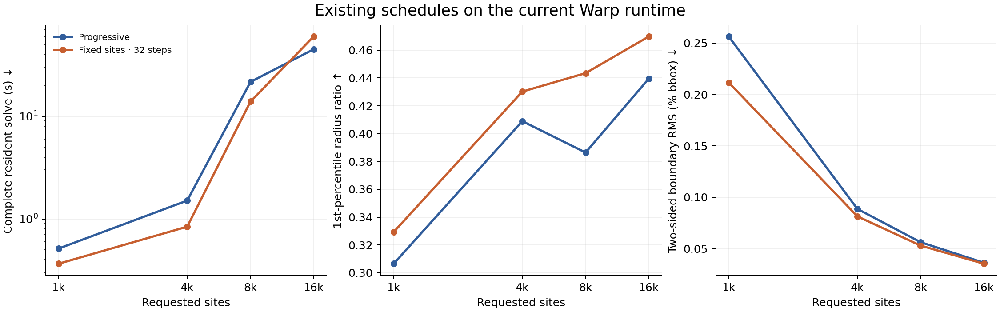

# Current schedule and mesh-size frontier

An existing fixed-site schedule improves complete-solve time and all nine checked
quality/fit metrics on the 1,000- and 8,192-site torus. It trades away worst-element
quality at 4,096 sites and becomes slower at 16,384 sites. **Defaults remain
unchanged, and the wide CPU speedup goal remains unmet.**

This study uses runtime `b44ab9e7332551a7a8a1c9bf9697f7bf8d7c109c` (numerical
source unchanged since `d8c0cab`), NVIDIA L40 and Warp 1.19.0. All GPU runs use the
same float32 48×24 torus surface, seed 2026 and four surface/crease subdivisions.
There are ten GPU configurations, with every explored outcome retained. This is
a single-input schedule study, not evidence for a universal schedule.



[PDF](../results/validation/vtm/fixed-site-current/fixed-site-current-frontier-v1.pdf)
and [SVG](../results/validation/vtm/fixed-site-current/fixed-site-current-frontier-v1.svg)
versions are available. Lines connect measured site budgets; they do not describe
continuous scaling or a fitted model.

## Existing public schedules

Progressive uses `(initial, growth steps, polish steps, selective steps, quality
rounds) = (256, 5, 20, 10, 4)`. Fixed20/fixed32 use all requested sites initially,
zero growth steps, 20/32 polish steps and the same selective/quality budgets.
Each timing is the median of three fresh captured solves after two initial
executions. Refit, fresh sampling, all fitting/reconstruction/recovery/quality
work and final extraction are included. Allocation, compilation, upload and
serialization are excluded; setup and first execution are recorded separately.
All initial and measured GPU quota windows are clean. Independent CPU geometry
checking runs after GPU timing, with one GPU process at a time.

Radius ratio is `3r/R` (larger is better). RMS is the two-sided area-weighted
sampled boundary distance as a percentage of the input bounding-box diagonal.
Signed volume error is relative to the input surface. Counts below are requested
sites; the raw records also give material-referenced vertices and tetrahedra.

| Sites / schedule | Complete s | Minimum ratio | 1st percentile | Median ratio | RMS % | Volume error % |
|---|---:|---:|---:|---:|---:|---:|
| 1000-progressive | 0.51336 | 0.09286 | 0.30648 | 0.87442 | 0.25623 | -5.0894 |
| 1000-fixed20 | 0.35532 | 0.12571 | 0.26919 | 0.87461 | 0.21433 | -4.3336 |
| 1000-fixed32 | 0.36533 | 0.14624 | 0.32926 | 0.88261 | 0.21151 | -4.2950 |
| 4096-progressive | 1.50883 | 0.05651 | 0.40896 | 0.88455 | 0.08865 | -1.7335 |
| 4096-fixed20 | 0.79738 | 0.06086 | 0.39523 | 0.88392 | 0.08277 | -1.6432 |
| 4096-fixed32 | 0.83992 | 0.04236 | 0.43023 | 0.89065 | 0.08143 | -1.6225 |
| 8192-progressive | 21.64939 | 0.04741 | 0.38643 | 0.88572 | 0.05631 | -1.0529 |
| 8192-fixed32 | 13.93365 | 0.05196 | 0.44348 | 0.89460 | 0.05301 | -1.0182 |
| 16384-progressive | 45.10212 | 0.03010 | 0.43958 | 0.89135 | 0.03636 | -0.6498 |
| 16384-fixed32 | 60.04970 | 0.01983 | 0.46984 | 0.89726 | 0.03538 | -0.6385 |

Fixed32 improves the minimum, 1st/5th/50th/95th-percentile ratios, both extreme
dihedral angles, RMS and absolute volume error at 1,000 and 8,192 sites. At 4,096
and 16,384 sites it improves the percentile ratios and fit but worsens the
minimum and extreme dihedrals. Fixed20 at 4,096 sites also lowers the 1st/5th
percentiles and median quality. Full distributions, roles, memory, work and
individual timing samples remain in the records; no quality tradeoff is hidden
by an aggregate score.

At 16,384 sites fixed32 makes 227 full-capacity reconstructions, compared with
161 for progressive plus 41 smaller-prefix reconstructions. Fewer global fitting
steps therefore do not imply less total work. Production at this revision also
uses fragment reuse only through 4,096 reserved sites; larger workspaces use
ordinary full reconstruction. [Issue #226](https://github.com/alecjacobson/warpower/issues/226)
tracks an isolated extension experiment. Its private results are not production
performance in this report.

## Native CPU size controls

The native source and binary hashes match the existing
[CGAL Mesh_3/ODT build](cpu-mesher-baseline.md): CGAL 6.2.1, GNU C++ 11.4.0,
`-O3 -DNDEBUG`, Xeon Platinum 8362 at 2.80 GHz under a four-core quota, sequential
or TBB limited to four threads. The exact float32 input surface matches the GPU.
Native time includes domain construction, feature protection, meshing and ODT;
file I/O, native validity checking, serialization and independent quality checks
are separate. GPU resident and native complete timings have these different
setup scopes and are not transfer-inclusive cold-start comparisons.

All settings use facet distance 0.025, facet angle 25 degrees, feature angle
45 degrees, cell radius-edge ratio 2, ODT iteration cap 50, convergence 0.02 and
freeze bound 0.01. Perturbation/exudation are disabled. Size 0.128 targets the
8k range; the first 0.102 size pilot undershoots 16k, so 0.099 is also measured.
Every three-sample batch and every mesh is retained. Quota-throttled samples
remain in the primary median; clean counts and subset medians are disclosed in
the raw records. These are size controls with quality/stopping-rule differences,
not quality-matched speedups.

| Size / CPU mode | Referenced vertices | Median s, all samples | Clean samples | Minimum ratio | 1st percentile | Median ratio | RMS % | Volume error % |
|---|---:|---:|---:|---:|---:|---:|---:|---:|
| 0.128 / 1 thread(s) | 7762 | 2.73866 | 3/3 | 0.04901 | 0.47848 | 0.89872 | 0.04271 | -0.7162 |
| 0.128 / 4 thread(s) | 8076–8109 | 1.18674 | 2/3 | 0.03209–0.05046 | 0.47256–0.48351 | 0.90210–0.90381 | 0.04182–0.04286 | -0.7221–-0.7026 |
| 0.102 / 1 thread(s) | 14677 | 4.94287 | 3/3 | 0.02549 | 0.48574 | 0.90255 | 0.02925 | -0.4612 |
| 0.102 / 4 thread(s) | 15371–15433 | 2.21542 | 1/3 | 0.03536–0.05705 | 0.49218–0.50479 | 0.90464–0.90556 | 0.02867–0.02890 | -0.4576–-0.4498 |
| 0.099 / 1 thread(s) | 15925 | 5.32111 | 3/3 | 0.00887 | 0.47794 | 0.90178 | 0.02791 | -0.4359 |
| 0.099 / 4 thread(s) | 16719–16762 | 2.44054 | 0/3 | 0.00481–0.02999 | 0.48959–0.49919 | 0.90482–0.90698 | 0.02717–0.02773 | -0.4319–-0.4211 |

Observed native ODT return codes: [3]. The source records preserve the
termination result of every sample. No equal-iteration or exact-count equivalence
is assumed, and this study does not establish a native CPU speedup.

## Validation and reproduction

All ten GPU outputs pass independent CGAL original-coordinate full-hull positive
orientation, global empty-sphere, face pairing and hull-support checks. Independent
material checks measure quality, positive volumes, incidence, topology and
surface distances. Every output boundary has single-cycle vertex links and zero
exact self-intersections. The native outputs receive positive-volume, incidence,
topology, quality and AABB surface-distance measurements for every distinct mesh;
this report does not add exhaustive native empty-sphere or self-intersection
audits. All material outputs have one component and torus boundary Euler
characteristic zero. RMS uses three area-weighted samples per triangle in each
direction and is not a Hausdorff certificate.

For the 4,096-site fixed32 schedule, from an installed checkout:

```bash
python -m benchmarks.mesher --case torus --n 4096 --initial 4096 \
  --growth-iterations 0 --polish-iterations 32 --selective-iterations 10 \
  --quality-rounds 4 --seed 2026 --subdivisions 4 --repeats 3 \
  --save-mesh results/local/fixed4096.npz --output results/local/fixed4096.json
```

Use `--initial 256 --growth-iterations 5 --polish-iterations 20` for the
progressive control. Build native references with
[the CPU instructions](../benchmarks/cpu/README.md). All exact commands, raw
samples, mesh snapshots, offline checks, plots, helper references and source/
binary hashes are in the
[manifest](../results/validation/vtm/fixed-site-current/manifest.json).
Native text meshes are losslessly gzip-compressed with both compressed and raw
hashes. Workspace-specific paths in the archived drivers identify provenance;
restore them under a separate checkout or adapt roots before reproduction.

This completes the bounded study in
[#225](https://github.com/alecjacobson/warpower/issues/225).
The implementation and wide comparable-quality CPU goal remain open in
[#29](https://github.com/alecjacobson/warpower/issues/29) and
[#40](https://github.com/alecjacobson/warpower/issues/40). Runtime, independently
callable diagram/Delaunay behavior, defaults and the README flagship are unchanged.
