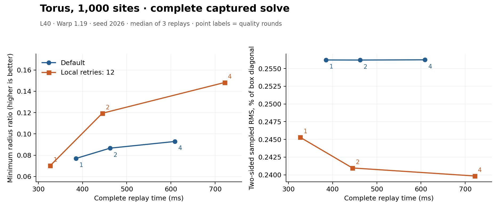

# Optional local quality backtracking

`VariationalMeshingWorkspace(..., local_quality_retries=12)` can keep a
selective proposal moving when a few tetrahedra reject the shared step. The
default is zero: it retains the original proposal kernels, storage and graph.
This is an optional optimization heuristic, with shape-dependent quality/time
tradeoffs. It does not change the fitting objective or add surface projection.

```python
mesher = warpower.VariationalMeshingWorkspace(
    domain, 4096, local_quality_retries=12,
)
with wp.ScopedCapture() as capture:
    domain.refit()
    mesher.run()
```

The [gallery](examples.md) accepts the same option:

```bash
python -m examples.vtm_gallery --case counterbored-plate --n 1000 \
  --local-quality-retries 12 --repeats 3 --output results/local/plate-local
```

## Transaction and fallback

Only a new rejection by the selective minimum-quality guard is eligible.
The implementation compares the rejection counter before and after the current
trial; a sticky error from an earlier trial cannot authorize a local retry.
Geometry, classification and objective failures use ordinary global backtracking.

The current retained tetrahedra whose radius ratios fall below the saved minimum
identify candidate vertices. Moved, selected vertices of those cells are blocked
for the next trial, which restores their original coordinates exactly. Other
vertices keep the current shared step. Blocking can accumulate across local
retries within one optimizer step. Original corner anchors, selective masks,
active-prefix handling and movement caps still apply.

Every trial reconstructs and certifies the complete current Delaunay mesh and
reruns the ordinary boundary/energy and selective quality checks. There is no
partial connectivity publication or weaker acceptance threshold. This is not a
proof that blocking those vertices removes the conflict: a newly appearing cell
can be caused by moving another site. No newly blocked vertices, an unsupported
failure, or an exhausted local budget restores the complete original direction
and resumes global backtracking. Exhausting the global budget restores the
starting points, connectivity and statistics through the existing transaction.

`local_quality_retries` is a setup integer in `[0, 2**31)`. It bounds additional
trials per optimizer step, beyond the core's `max_backtracks` budget. There are
at most `1 + max_backtracks + local_quality_retries` attempted reconstructions
per step. A positive setting requires quality rounds in the public mesher, or
`selective_threshold` in the internal core. Quality-stage and iteration budgets
retain their existing meanings.

## Device state and limitations

The option adds an int32 block mask of one entry per reserved site and six
int32 scalar entries, or `4 * capacity + 24` bytes of explicit array storage.
Graph/runtime storage is additional. All masks, reductions, eligibility checks,
retry decisions and resets remain on device. Fresh core invocations and optimizer
steps reset the appropriate state; ordinary fallback clears the block mask.
No host allocation, readback, synchronization or graph recapture is needed during
replay. Independent diagram and Delaunay constructors do not allocate this state
or import the helper.

`core.local_backtracking.statistics` records local retries and vertex-blocking
events during the most recent core invocation. `core.rejected_steps` and the
selective rejection counter include rejected local trials. These child counters
are not accumulated totals for the complete mesher scheduler.

The selective guard preserves its starting material minimum for accepted
selective steps. This does not guarantee the same final mesh, a better minimum,
or less work than a solve with the option disabled. Other quality stages retain
their existing acceptance rules. An accepted zero-movement proposal can terminate
the core even though blocked directions remain. As with the original movement
test, that termination does not establish optimality.

The motivating [midpoint/hand investigation](representable-boundary-probe.md)
and [issue #202](https://github.com/alecjacobson/warpower/issues/202) track the
quality and performance evaluation. The midpoint correction itself remains
unadopted. This option uses ordinary rounding.

## Complete-solve measurements

Runtime `6aa4ba6` was compared with baseline `39f8f54` on NVIDIA L40 / Warp 1.19.
Each number is the median of three additional **complete fresh replays**, including
domain/sizing refits, sampling, growth, optimization, recovery, extraction and
final diagnostics. Setup, upload, download and independent validation are outside
these times; first-replay timings are retained separately. All recorded first and
repeated timings have clean CPU quota counters. This is not CPU outperformance
evidence.

All rows below use four quality rounds and seed 2026 unless noted. Enabled runs
use `local_quality_retries=12`. Surface RMS is independently sampled in both
directions and expressed as a percentage of the input bounding-box diagonal;
it is not a Hausdorff bound. The full percentile distributions, volumes,
dihedrals, topology checks and per-feature records accompany each result.

| Example | Time, ms default → enabled | Minimum radius ratio default → enabled | Two-sided RMS, % default → enabled |
|---|---:|---:|---:|
| torus 1k | 608.98 → 721.32 | 0.09286 → 0.14823 | 0.25623 → 0.23984 |
| torus 4k | 1784.47 → 1496.37 | 0.05651 → 0.09152 | 0.08865 → 0.08717 |
| graded torus 4k | 2050.34 → 1836.81 | 0.06769 → 0.11786 | 0.13487 → 0.13435 |
| dense hand 1k | 1333.20 → 1231.03 | 0.09352 → 0.09521 | 0.03446 → 0.03419 |
| plate 1k | 1065.66 → 925.41 | 0.10275 → 0.23999 | 0.08702 → 0.08402 |
| cavity 1k | 445.42 → 511.19 | 0.23681 → 0.18442 | 0.16778 → 0.12321 |
| disconnected 1k | 501.10 → 608.43 | 0.08111 → 0.12647 | 0.01984 → 0.00129 |
| uniform Armadillo 4k | 2844.99 → 2585.37 | 0.05256 → 0.04716 | 0.24166 → 0.24182 |
| graded Armadillo 4k | 3513.01 → 3211.60 | 0.07408 → 0.07408 | 0.27517 → 0.27518 |
| plate 1k, seed 7 | 1169.63 → 976.74 | 0.04256 → 0.15004 | 0.08149 → 0.08493 |

The cavity becomes slower with a worse minimum. Uniform Armadillo becomes faster
but has a worse minimum and slightly worse fit. The plate's alternate seed trades
some surface accuracy for better minimum quality and time. Equal round budgets
also do not imply equal optimization work: local rollback can continue after a
global step would have stalled. These are reasons to keep activation explicit.

### Feature fitting

Corners match exactly in the checked hand and plate outputs. Crease fitting is
approximate, and surface RMS alone does not describe it. Length-weighted sampled
input-crease-to-output-surface RMS changes as follows (model units):

| Example | Crease RMS default → enabled | Worst crease-site deviation default → enabled |
|---|---:|---:|
| dense hand 1k | 0.0032202 → 0.0032675 | 0.0470588 → 0.0470588 |
| plate 1k | 0.0042708 → 0.0047171 | 0.0657599 → 0.0611216 |
| plate 1k, seed 7 | 0.0040780 → 0.0050306 | 0.0327497 → 0.0804917 |

All three sampled crease RMS values worsen, and seed 7's largest crease-site
deviation rises substantially. These measurements include per-chain records and
maximum sample distances; they do not establish constrained-edge conformity.
The option does not resolve [#149](https://github.com/alecjacobson/warpower/issues/149).

### Time to quality

The torus sweep retains every tested budget: one, two and four rounds.
Two enabled rounds take **444.84 ms**, with minimum ratio **0.11936** and sampled
surface RMS **0.24097%** of the diagonal. Four default rounds take **608.98 ms**,
with minimum **0.09286** and RMS **0.25623%**. That is 27% less replay time at better
minimum ratio and sampled fit for this example. One enabled round has a worse minimum than
one default round, while four enabled rounds cost more than four default rounds.



### Failure, compatibility and provenance

Both dense-hand seed-7 runs fail before selective optimization with error 64 and
zero public counts. They reach all 1,000 sites, but the material-boundary validity
gate rejects them after three recovery rounds. Both coarse-hand 4/4-quadrature
runs also fail explicitly. These four results are retained and are **not** valid
mesh performance results. The seed failure stopped the first harness; the resumed
harness preserves all earlier outputs and records. It is tracked separately in
[#205](https://github.com/alecjacobson/warpower/issues/205).

Three disabled-option/default pairs preserve counts, topology, roles and all
recorded optimizer work. Torus and plate positions match bitwise; the hand's
largest coordinate difference is 1.63e-19. Median time changes span -0.06% to
+0.79%. Five independent diagram/Delaunay pairs preserve recorded inputs/outputs,
counts, statuses and diagnostics, with median changes from -0.29% to +0.75%.
They do not allocate local-retry state, and their source/defaults are unchanged.

All 27 valid production meshes pass independent CGAL global empty-sphere,
orientation, hull/face checks, NumPy physical measurements, sampled AABB surface
distances, boundary vertex-link checks, exact VTU round-trips and checked boundary
self-intersections. The full suite passes 1,034 tests; the focused suite passes
46, including bounded rejection, stale reasons, captured producer/consumer
failure recovery, active prefixes, grading and exact corner anchors.

All seven new tests also pass padded Compute Sanitizer memcheck and a second
lifetime audit with the memory pool disabled, with zero reported errors. The
first combined sanitizer job reached its 600-second limit without a final
summary; its log is retained. The successful rerun covers the same tests in
three isolated groups per mode, with 900-second limits and no kernel exclusions.
These instrumented tests use the existing 131,072-byte diagnostic CUDA stack
limit; production timing and native traces use the normal runtime configuration.

Two native Nsight traces check the first launch of a complete plate solve and a
captured three-phase producer/optimizer/consumer loop. The full solve executes
45 local retries; the loop executes six. The loop changes the active prefix
64 → 0 → 64, reports errors 0 → 8 → 0, resets failed output counts and local
statistics, preserves the inactive NaN tail, and produces matching downstream
volume sums. Both traces contain only device-to-device copies, and their graph
exports contain only kernels, device copies, memsets and conditional nodes.
There are no replay host callbacks, host transfers or allocation/free nodes.
Each trace has one final external synchronization; first-launch graph
instantiation/upload is recorded separately from the device computation.

The [artifact manifest](../results/validation/vtm/local-quality-backtracking/manifest.json)
records all experimental policies, failure logs, production runs, source hashes,
independent checks, and the lower-round sweep. The private experimental test that
expected exactly three rejections fails because local retries add attempts; the
new production tests validate the explicit combined bound and complete rollback.
An initial private recovery test incorrectly required acceptance with an
insufficient budget; it was corrected to compare recovery with a fresh identical
workspace. The original failed runs remain in the bundle. No midpoint correction
or relaxed quality acceptance was adopted.
