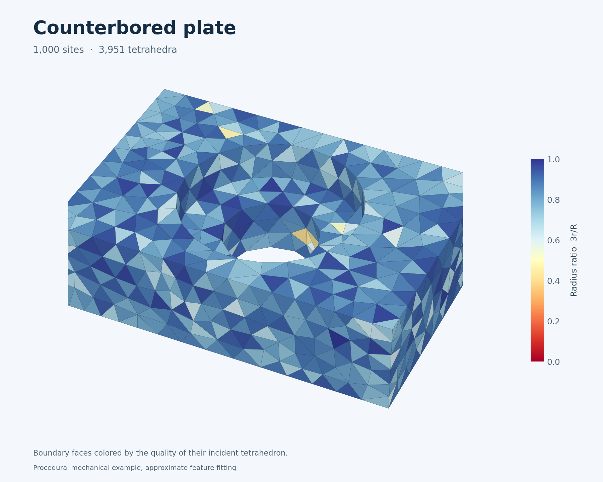
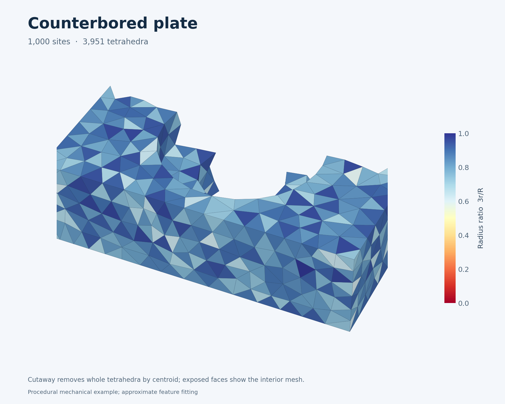

# Sharp-feature mechanical example

The counterbored plate exercises planar walls, a stepped through-hole, concave
rims and eight prescribed corners. It is a new procedural mechanical substitute,
not Alliez et al.'s original fandisk asset. The complete captured mesher produces
**3,951 material tetrahedra from 1,000 sites in 1.629 s** on the L40. The hole and
all corners are retained; crease fitting remains approximate, with measured
limitations below. This result does not establish CPU outperformance.

| Surface | Tetrahedral cutaway |
|---|---|
|  |  |

Colors show incident tetrahedron radius ratio. The cutaway removes whole cells
by their centroid; the saved mesh is complete. Download the
[VTU mesh](../results/examples/vtm/counterbored-plate/mesh.vtu),
[NPZ arrays](../results/examples/vtm/counterbored-plate/mesh.npz),
[timing record](../results/examples/vtm/counterbored-plate/result.json),
[independent validation](../results/examples/vtm/counterbored-plate/independent-validation.json)
and [feature audit](../results/examples/vtm/counterbored-plate/feature-quality.json).

## Input and controls

[`counterbored_plate`](../examples/vtm_inputs.py) builds six matching rings with
32 uniform azimuths and four exact rays through the rectangular corners. The
outer footprint is 2.5 × 1.7, with bottom/top at −0.35/+0.35. The lower bore has
radius 0.35, widening to 0.65 above the shoulder at z=0.05. Triangulated matched
quads produce a closed 216-vertex, 432-triangle surface without Boolean repair.
The bore is polygonal. Its independently integrated volume is 2.4263534393.
CGAL finds no input self-intersections.

The actual 45° feature and corner thresholds detect 220 crease segments and
eight corners. Those segments form 12 open outer-edge chains and four closed
bore rims. The run uses uniform sizing, seed 2026, 256 initial sites, a 1,000-site
target, four quality rounds and 16 subdivisions for both surface and crease
quadrature: 331,776 surface slots and 41,472 crease slots. The latter capacity
also reserves inactive slots for nonfeature edges. No extraction recovery is
activated in this case.

Host input generation and upload precede capture. Each complete replay includes
domain refit, fresh sampling, four growth rounds, 40 global optimization steps,
11 selective steps, quality improvement and material extraction. File export,
independent CPU validation and rendering follow replay and are excluded from
the device timing. Those offline tools are not mesher dependencies or fallbacks.

## Independently checked result

| Measurement | Result |
|---|---:|
| Sites / material-referenced sites | 1,000 / 1,000 |
| Full-hull / material tetrahedra | 5,458 / 3,951 |
| Boundary triangles | 1,338 |
| Material components / boundary Euler characteristic | 1 / 0 |
| Radius ratio: minimum / 1st / 5th percentile | 0.10275 / 0.34753 / 0.56018 |
| Radius ratio: mean / median / 95th percentile | 0.81736 / 0.84684 / 0.95788 |
| Minimum / maximum dihedral angle | 4.956° / 171.907° |
| Material volume / relative error | 2.43838703 / +0.4960% |
| Two-sided boundary RMS / input box diagonal | 0.08702% |
| First complete replay | 1.822 s |
| Median of five additional complete replays | 1.629 s |
| Setup, including graph construction, with warm module cache | 1.440 s |

Timings use NVIDIA L40, Warp 1.19.0, example/audit revision `04c4e85` and the
unchanged geometry runtime from `32ee3c6` (main `c61e122`). All observed setup and
timing windows have zero CPU quota throttling. The five warm samples are
1.62855, 1.62782, 1.62831, 1.63255 and 1.62953 seconds. The saved last replay has
the same bitwise coordinates, roles, canonical cell sets and oriented boundary
as the initial 16-subdivision pilot; parallel output order can differ.

CGAL 6.2.1 checks every full-hull cell's original-coordinate orientation,
5,436,168 global empty-sphere predicates, face pairing, and 410 hull faces
against all 1,000 sites. It accepts four exact cospherical ties. Independent
NumPy calculations verify material incidence, positive volumes, radius ratios
and dihedrals; every boundary vertex link is one cycle. Exact CGAL surface checks
find zero boundary self-intersection pairs. VTU round trips reproduce saved
coordinates, material connectivity and quality exactly. The two-sided distance
metric uses three area-weighted samples per face and CGAL AABB distances; it is
not a Hausdorff bound or a prescribed quality guarantee.

## Feature fit and remaining limitation

All eight corners match input float32 coordinates exactly on the material
boundary. All 191 crease-role sites are boundary referenced. Their distances to
the nearest input feature have median 0.00000159, 95th percentile 0.004118 and
maximum **0.06576**. The worst site is assigned to an outer top edge; the maximum
therefore matters even though most sites fit much more closely.

Independent projection assigns each boundary crease-role site to its nearest
input chain and orders it by arclength, adding exact corner anchors on open
chains. Every chain has assigned sites. The maximum normalized spacing gap is
28.125% of one short vertical edge. Of 203 consecutive pairs, **three are not
boundary edges**, all on the upper shoulder rim. This is an offline geometric
diagnostic, not runtime sample ownership or an exact-conformity certificate.

Length-weighted input-crease-to-output-boundary RMS is **0.004271**, or 0.1376%
of the input box diagonal. The largest sampled distance is 0.05648. This uses
16 midpoint samples on each of 220 segments; neither number bounds unsampled
distance. [Issue #149](https://github.com/alecjacobson/warpower/issues/149) tracks
localizing and improving the worst errors and shoulder-rim connectivity.

This behavior is consistent with the documented [centroid fitting](boundary.md)
contract. Alliez et al., [§3.5](https://www.cs.jhu.edu/~misha/ReadingSeminar/Papers/Alliez05.pdf),
likewise fit boundary and feature samples through weighted centroids. A centroid
can leave a curved input feature. The example does not promise exact edge
conformity, and increasing quadrature alone is not a monotone quality improvement.

We retain all three tried quadrature settings at the same site budget:

| Subdivisions, surface / crease | Minimum radius ratio | Two-sided RMS / box diagonal | Volume error | Crease-to-boundary RMS | Missing consecutive pairs |
|---|---:|---:|---:|---:|---:|
| 4 / 4 | 0.08968 | 0.12524% | +0.7255% | 0.008771 | 13 / 200 |
| 8 / 8 | 0.06952 | 0.13293% | +0.6056% | 0.007107 | 5 / 202 |
| 16 / 16 | 0.10275 | 0.08702% | +0.4960% | 0.004271 | 3 / 203 |

All three pass independent full-hull, material topology, self-intersection,
quality and corner checks. The 16-subdivision result is the gallery default;
the others remain in the [validation artifacts](../results/validation/vtm/mechanical/).
Their first replays are exploratory observations, not a paired warm timing study.

## Reproduction and validation

From a source checkout with `pip install -e '.[dev,bench]'`:

```bash
python -m examples.vtm_gallery --case counterbored-plate --n 1000 --initial 256 \
  --seed 2026 --feature-angle 45 --corner-angle 45 --quality-rounds 4 \
  --repeats 5 --output results/local/plate
python -m benchmarks.mesh_quality results/local/plate/mesh.npz \
  --output results/local/plate/independent-quality.json
python -m benchmarks.feature_quality results/local/plate/mesh.npz \
  --output results/local/plate/feature-quality.json
python -m examples.vtm_render results/local/plate/mesh.npz --axis y --fraction 0.6 \
  --azimuth -65 --elevation 40 --title 'Counterbored plate' \
  --output results/local/plate/cutaway.png
```

Both offline measurement commands can use the optional native distance oracle
via `--distance-binary`; see the [native build instructions](../benchmarks/cpu/README.md).
The [manifest](../results/validation/vtm/mechanical/manifest.json) records source,
input, output and validation hashes and preserves the pilot meshes.

Eleven focused tests pass, including a full captured plate solve, analytic input
volume/topology/features, and independent-audit controls with deliberately
displaced sites, a lost corner and a missing edge. All 11 also pass unfiltered
32-byte-padded memcheck (73.53 s) and a separate use-after-free/API-memory check
with the diagnostic array pool disabled (88.92 s), each with zero errors. These
instrumented runs use a diagnostic-only 128 KiB CUDA stack allowance; normal
execution and timing use the default context configuration.

Full allocation-order tracking **fails** with 43 native CUB scratch accesses
reported before allocation. The retained
[failure log](../results/validation/vtm/mechanical/mechanical-memcheck.log) points
to 11,775-byte conditional radix-sort scratch. A standalone 8,192-key Warp sort,
with no Warpower geometry, reproduces the same kernel, instruction offset and
scratch size under that checker; its top-level sort and conditional
use-after-free controls pass. These are fresh controls for the previously
isolated [conditional-sort tracking limitation](cuda-validation.md#conditional-native-radix-sort-scratch),
not a blanket lifetime proof. No runtime allocator workaround or checker
suppression was introduced. Raw failures, passing logs and exact commands are
retained in the validation artifacts.

The separate [native replay audit](../results/validation/vtm/mechanical/mechanical-native-audit.json)
records 132,453 kernel activities across three complete solves, three graph
submissions and one final synchronization. All 994 DOT copy nodes and all
observed copies are device-to-device. There are no host callbacks, host/device
transfers, or allocation/free nodes in replay. The compressed DOT and SQLite
trace are included for independent inspection.

This example changes no
`warpower` runtime code; the independently callable power-diagram and Delaunay
paths retain the [latest performance gate](hull-witness-stop.md). The main README
retains the earned Paragram result; [the CPU mesher target](cpu-mesher-baseline.md)
remains open.
