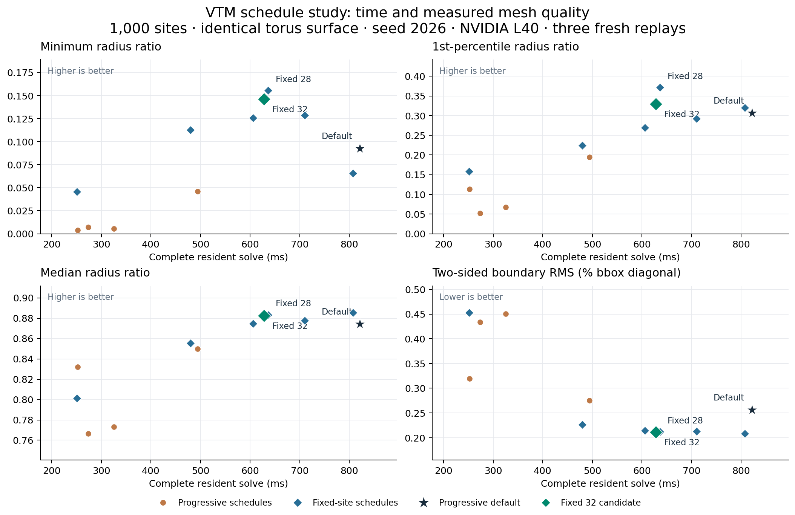

# Progressive and fixed-site VTM schedules

Starting with all 1,000 sites and using 32 global fitting iterations takes
**628 ms versus 823 ms** for the progressive default on the seed-2026 torus:
23.7% less resident solve time. The minimum, 1st/5th/50th/95th-percentile radius
ratios, extreme dihedral angles, sampled boundary RMS and absolute volume error
all improve in this comparison. All 1,000 sites are referenced by both outputs.
The fixed schedule does not improve every quality metric on other inputs or even
the second torus seed, so **the runtime defaults remain unchanged**.

This completes the progressive/fixed-budget comparison in issue #37. It does
**not** establish the wide CPU speedup required by #40. The existing native CGAL
baseline still has different output counts and better boundary fit; see
[the CPU comparison](cpu-mesher-baseline.md).



[Download the plot as PDF](../results/validation/vtm/quality-frontier/quality-time.pdf).
Every marker is a complete solve under an existing public scheduling option.
The plot uses the exploratory three-replay measurements; the fresh confirmation
batch below uses five replays. No runtime kernel or default changed in this study.

## Scope and measurements

All runs use source `9228a3e7b3804b0cf1b191976477e35c25dc47ef`, Warp 1.19.0 and an
NVIDIA L40. The initial study uses the same float32 48×24 torus surface as the
[CPU baseline](cpu-mesher-baseline.md), seed 2026 and 1,000 requested sites.
Each captured graph refits the domain, samples fresh initial sites, executes its
configured growth/global fitting/selective/jitter/interior-improvement stages,
and finishes extraction and diagnostics. Replay includes device decisions and
all necessary reconstruction. It excludes allocation, compilation, transfer and
serialization; setup and first execution are recorded separately.

After two initial executions, the study records three timed fresh solves per
exploratory configuration and five per confirmation configuration. Every initial
and timed window has zero observed CPU quota throttling. There were no invalid
or timeout cases among these 20 configurations. Each invocation has a 180-second
limit; the drivers preserve failure records rather than selecting only successes.

For the confirmed seed-2026 torus, progressive/fixed setup takes 1.513/1.322 s
with an already populated compiler cache, and first graph execution takes
1.061/0.800 s. These are separate from the 0.823/0.628 s replay medians.
They are not cold installation or transfer-inclusive end-to-end times.

## Exploration

Budgets are `(initial sites, growth iterations, polish iterations, selective
iterations, quality rounds)`. Growth is disabled for the fixed-site schedules.
RMS is the area-weighted two-sided sampled boundary distance divided by the input
bounding-box diagonal. Signed volume errors are relative to the input surface.
Radius ratio is `3r/R`; larger is better. The full records also include the 5th,
95th and 100th percentiles, mean quality, both extreme dihedral angles, counts,
roles, work performed, memory and first/setup times.

| Schedule | Budgets | Median ms | Minimum | 1st percentile | Median quality | Boundary RMS | Volume error |
|---|---|---:|---:|---:|---:|---:|---:|
| control | (256, 5, 20, 10, 4) | 821.5 | 0.0929 | 0.3065 | 0.8744 | 0.2562% | -5.089% |
| short | (256, 2, 5, 3, 1) | 325.5 | 0.0054 | 0.0676 | 0.7732 | 0.4502% | -8.582% |
| intermediate | (256, 3, 10, 5, 2) | 494.1 | 0.0462 | 0.1949 | 0.8500 | 0.2755% | -5.459% |
| no-quality | (256, 3, 10, 0, 0) | 252.7 | 0.0037 | 0.1133 | 0.8320 | 0.3196% | -6.223% |
| initial512 | (512, 2, 5, 3, 1) | 273.9 | 0.0071 | 0.0518 | 0.7666 | 0.4336% | -8.077% |
| fixed-short | (1000, 0, 5, 3, 1) | 251.3 | 0.0458 | 0.1584 | 0.8015 | 0.4530% | -8.701% |
| fixed-intermediate | (1000, 0, 10, 5, 2) | 479.9 | 0.1126 | 0.2244 | 0.8554 | 0.2265% | -4.536% |
| fixed-full | (1000, 0, 20, 10, 4) | 605.8 | 0.1257 | 0.2692 | 0.8746 | 0.2143% | -4.334% |
| fixed-24 | (1000, 0, 24, 10, 4) | 710.0 | 0.1287 | 0.2920 | 0.8776 | 0.2131% | -4.315% |
| fixed-28 | (1000, 0, 28, 10, 4) | 636.3 | 0.1556 | 0.3716 | 0.8834 | 0.2117% | -4.302% |
| fixed-32 | (1000, 0, 32, 10, 4) | 628.0 | 0.1462 | 0.3293 | 0.8826 | 0.2115% | -4.295% |
| fixed-40 | (1000, 0, 40, 10, 4) | 807.3 | 0.0658 | 0.3201 | 0.8856 | 0.2085% | -4.243% |

Short schedules save time at appreciably lower quality. The 20-step fixed
schedule has a worse 1st percentile than the progressive default; this motivated
the subsequent 24/28/32/40-step sweep. Both 28 and 32 improve the reported lower
tail and fit. Forty steps produce a worse minimum despite improving median quality.
More iterations therefore do not guarantee better worst-element quality or a
monotonic time curve: the fitted trajectory changes the later repair work.

## Fresh confirmation and limits

The 32-step option was selected after the exploratory sweep. A new five-replay
batch compares it to the progressive default on the original seed, a second
torus seed, a cavity and disconnected solids. Both schedules use identical input
surfaces and sampling settings within each pair: four surface subdivisions for
the torus, 20 for cavity/disconnected, and the benchmark's default four crease
subdivisions. These latter settings differ from the gallery's denser crease
quadrature. The recorded commands are authoritative.

| Input / seed / schedule | Median ms | Minimum | 1st percentile | Median quality | Boundary RMS | Volume error |
|---|---:|---:|---:|---:|---:|---:|
| torus-2026-progressive | 822.6 | 0.0929 | 0.3065 | 0.8744 | 0.2562% | -5.089% |
| torus-2026-fixed-32 | 627.8 | 0.1462 | 0.3293 | 0.8826 | 0.2115% | -4.295% |
| torus-2027-progressive | 898.0 | 0.1265 | 0.3519 | 0.8785 | 0.2356% | -4.776% |
| torus-2027-fixed-32 | 697.6 | 0.1227 | 0.3667 | 0.8856 | 0.2158% | -4.400% |
| cavity-2026-progressive | 1060.4 | 0.1388 | 0.3471 | 0.8691 | 0.1989% | -1.035% |
| cavity-2026-fixed-32 | 453.3 | 0.1299 | 0.3322 | 0.8675 | 0.1481% | -0.521% |
| disconnected-2026-progressive | 999.5 | 0.1122 | 0.3640 | 0.8745 | 0.1042% | -1.411% |
| disconnected-2026-fixed-32 | 706.9 | 0.1958 | 0.4123 | 0.8754 | 0.0723% | -0.686% |

The second torus seed is 22.3% faster with better percentile quality and fit, but
its minimum ratio falls from 0.1265 to 0.1227 and its extreme dihedral angles
worsen slightly. The cavity is 57.2% faster with better fit but worse minimum,
1st/5th-percentile and median quality. Disconnected solids are 29.3% faster with
better lower-tail/median quality, fit and dihedral extremes; the 95th percentile
declines from 0.96893 to 0.96732. These are tradeoffs, not universal replacements
for the default. Only the original torus improves all nine selected metrics in
[the explicit comparison](../results/validation/vtm/quality-frontier/comparison.json).
No claim of optimal scheduling or of generalization beyond these inputs is made.

The original torus changes from 4,225 to 4,006 material tetrahedra and from 562 to
613 surface-role sites, with the same 1,000 referenced vertices. Its better fit
partly accompanies a different boundary/interior allocation. Equal vertex count
does not imply identical element count or identical optimization trajectories.

## Validation and reproduction

All 20 full-hull outputs pass independent CGAL 6.2.1 exact positive-orientation,
global empty-sphere, paired-face and supporting-hull checks. Independent NumPy
geometry checks material orientation, topology, radius ratios and dihedral angles;
CGAL AABB distances measure the two sampled boundary-error directions. Every
boundary vertex has a single cycle link, and every material boundary has zero
exact self-intersections. Torus, cavity and disconnected output topology matches
the corresponding input. The RMS quadrature uses three points per triangle and
is not a Hausdorff certificate. The fresh seed-2026 pair reproduces the exploratory
points and roles bitwise, the full/material tetrahedron sets exactly, and the
oriented boundary triangles exactly.

For the confirmed torus pair, run from an installed checkout:

```bash
python -m benchmarks.mesher --case torus --n 1000 --initial 256 --seed 2026 \
  --growth-iterations 5 --polish-iterations 20 --selective-iterations 10 \
  --quality-rounds 4 --repeats 5 --save-mesh results/local/progressive.npz \
  --output results/local/progressive.json
python -m benchmarks.mesher --case torus --n 1000 --initial 1000 --seed 2026 \
  --growth-iterations 0 --polish-iterations 32 --selective-iterations 10 \
  --quality-rounds 4 --repeats 5 --save-mesh results/local/fixed-32.npz \
  --output results/local/fixed-32.json
python -m benchmarks.mesh_quality results/local/fixed-32.npz \
  --distance-binary results/local/surface-distance \
  --output results/local/fixed-32-quality.json
```

Build the independent references using [the native benchmark instructions](../benchmarks/cpu/README.md).
The [artifact manifest](../results/validation/vtm/quality-frontier/manifest.json)
records source and reference hashes. It covers all raw timings, saved meshes,
independent checks, original drivers, exact commands and plotting source under
[the experiment directory](../results/validation/vtm/quality-frontier).
No standalone power-diagram or Delaunay code is modified, and the main README's
Paragram flagship result is unchanged.
