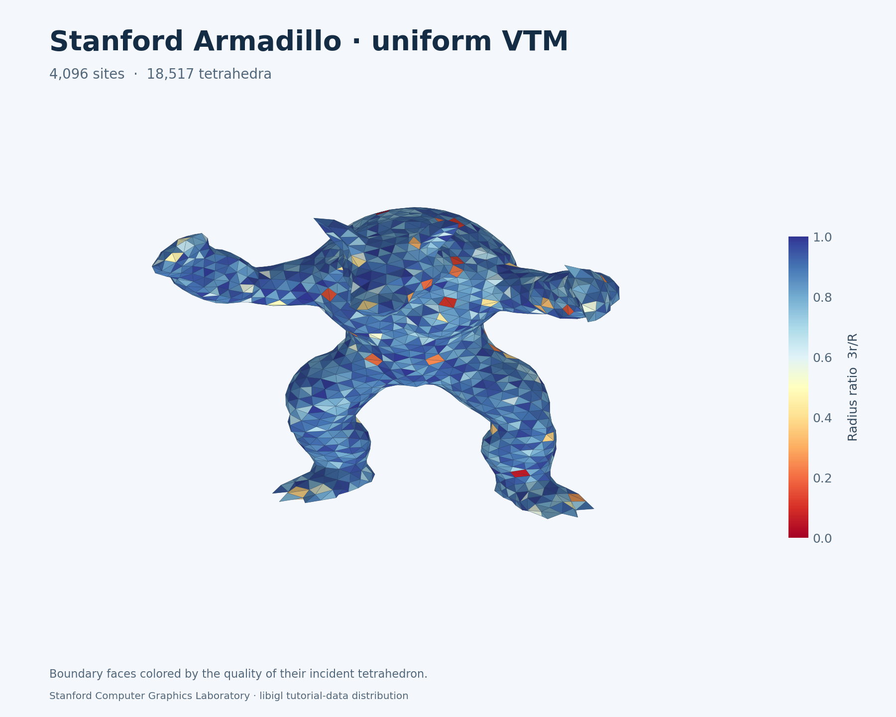
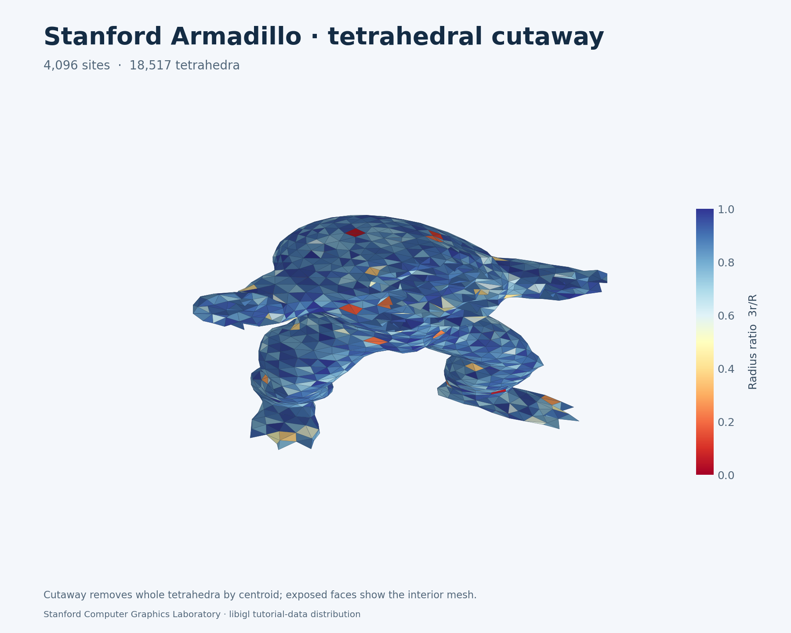

# Scanned Armadillo example

The uniform example meshes a closed Stanford Armadillo surface with 43,243 input
vertices and 86,482 triangles. It uses the reduced distribution in pinned libigl
tutorial-data, attributed to the Stanford Computer Graphics Laboratory. This is
an additional scanned benchmark alongside the examples inspired by Alliez et al.
Armadillo is not one of the models illustrated in that paper.

The downloader verifies the source SHA256 before centering the bounding box,
dividing coordinates by half its largest extent, and converting to float32.
Connectivity is unchanged; no holes are filled and no geometry is simplified or
repaired. Source identity, normalization and output hash are retained in
[input provenance](../results/examples/vtm/armadillo-uniform/input-provenance.json).
The [Stanford terms](https://graphics.stanford.edu/data/3Dscanrep/) permit research
use and free redistribution with attribution; commercial use requires permission.
The [data notice](../results/examples/vtm/armadillo-uniform/NOTICE.md) applies to
the model-derived arrays and figures separately from the repository code license.

From a source checkout with example dependencies:

```bash
python -m examples.fetch_armadillo --output results/local/armadillo-input
python -m examples.vtm_gallery --case surface \
  --input results/local/armadillo-input/armadillo.off \
  --n 4096 --initial 256 --seed 2026 \
  --subdivisions 1 --crease-subdivisions 1 \
  --feature-angle 120 --corner-angle 45 --quality-rounds 4 --repeats 3 \
  --output results/local/armadillo-uniform
```

The explicit 120-degree feature threshold treats this scan as smooth: the device
finds zero creases and corners. The gallery's default feature/corner thresholds
remain 45 degrees for other examples. Quadrature subdivision one already supplies
259,446 surface samples on this dense input. Source preparation and file I/O are
outside the captured meshing loop.

## Validated uniform result

| Measurement | Uniform Armadillo |
| --- | ---: |
| Sites in full hull / referenced by material cells | 4,096 / 4,090 |
| Full-hull / material tetrahedra | 24,721 / 18,517 |
| Material boundary triangles | 3,806 |
| Material components / boundary Euler characteristic | 1 / 2 |
| Minimum / first percentile / median radius ratio, 3r/R | 0.05256 / 0.40945 / 0.89222 |
| Minimum / maximum dihedral angle | 2.54° / 175.90° |
| Two-sided sampled boundary RMS / input box diagonal | 0.2417% |
| Relative volume error | −3.1419% |
| Complete resident solve, median of three warm replays | 20.834 s |
| First complete replay | 21.729 s |
| Setup, including graph construction | 2.746 s |

The L40 / Warp 1.19.0 run starts from 256 sites, performs seven growth rounds,
one extraction-recovery round and four quality rounds. Every replay includes
input-domain refit and validation, fresh sampling, progressive growth/fitting,
quality improvement and final extraction. All measured CPU quota windows are
unthrottled. Compilation/setup, transfers, independent checking and export are
separate from resident replay timing. This result establishes no CPU speedup.

Independent CGAL 6.2.1 exact predicates verify every full-hull tetrahedron's
orientation and global empty sphere, face pairing and hull support. The resulting
material boundary has no self-intersections; independent incidence checks and
single-cycle vertex links establish its manifold topology. NumPy independently
reproduces cell quality, dihedrals and volume. The VTU arrays round-trip exactly.
The earlier exact input self-intersection result is reused only after verifying
that the normalized input OFF bytes are identical. See the
[independent checks](../results/examples/vtm/armadillo-uniform/independent-checks.json)
and [quality report](../results/examples/vtm/armadillo-uniform/independent-quality.json).

| Material surface | Interior cutaway |
| --- | --- |
|  |  |

Colors show the incident tetrahedron's radius ratio. The cutaway removes whole
cells by centroid; it does not modify the exported mesh. Download the
[VTU](../results/examples/vtm/armadillo-uniform/mesh.vtu),
[NPZ arrays](../results/examples/vtm/armadillo-uniform/mesh.npz), or
[raw timing record](../results/examples/vtm/armadillo-uniform/result.json).
The [manifest](../results/examples/vtm/armadillo-uniform/provenance.json) pins
runtime `6387888`, example/oracle `7765cb8`, renderer revision and artifact hashes.

The preview supports explicit camera orientation and dataset credits:

```bash
python -m examples.vtm_render results/local/armadillo-uniform/mesh.npz \
  --axis z --fraction 0.6 --up-axis y --azimuth -20 --elevation 15 \
  --title 'Stanford Armadillo · tetrahedral cutaway' \
  --credit 'Stanford Computer Graphics Laboratory · libigl tutorial-data distribution' \
  --output results/local/armadillo-uniform/cutaway.png
```

## Independent distances on dense surfaces

The optional native AABB distance oracle makes offline boundary-fit validation
practical for the 86,482-triangle input. Build it as described in the
[native reference instructions](../benchmarks/cpu/README.md), then run:

```bash
python -m benchmarks.mesh_quality results/local/armadillo-uniform/mesh.npz \
  --distance-binary results/local/surface-distance \
  --output results/local/armadillo-uniform/independent-quality.json
```

This oracle is used after GPU timing. NumPy still computes cell quality and
incidence; only triangle-distance queries use the independently built CGAL tree.
The distance constructions use float64. Both directions use three quadrature
points per surface triangle, so the reported RMS is a sampled metric rather than
a Hausdorff certificate. The
[oracle audit](../results/examples/vtm/armadillo-uniform/distance-oracle-audit.json)
checks 918 translated/scaled single- and multiple-triangle queries against known
projections and the existing brute-force reference, five rejected-input cases,
empty queries and an entire two-sided quality report. Binary/source hashes and
CGAL version are recorded with each report.

The Warpower runtime package and main README are byte-identical to `6387888`.
These additions affect examples, rendering and independent validation. The four
existing example-domain tests pass; the runtime's preceding full suite has 564
passing tests. No native oracle is called by the device meshing pipeline.

## Preserved graded failure

Changing only `--case` to `graded-surface` with these budgets currently fails
material extraction. The existing min-cone sizing field ranges from relative
size 0.35 on the left to at most 1 elsewhere. Input validation succeeds, but the
final material selection has two edges incident to four boundary triangles.
The public mesher correctly returns error 64, valid 0 and zero output counts.
Its failed first replay takes 7.888 s; this is not a valid-mesh performance result.

The saved internal candidate has 4,096 sites, 24,677 independently certified
full-hull tetrahedra and 18,769 selected cells. Its two offending edges are
`(234, 1343)` and `(1296, 2965)`. Containment recovery adds no cells. The
[failed candidate and diagnostics](../results/validation/vtm/graded-armadillo-failure/NOTICE.md)
are retained separately from the valid uniform example. See the
[edge analysis](../results/validation/vtm/graded-armadillo-failure/failure-analysis.json),
[full-hull check](../results/validation/vtm/graded-armadillo-failure/full-hull-check.json)
and [failure report](../results/validation/vtm/graded-armadillo-failure/result.json).

Recovery is tracked in [issue #142](https://github.com/alecjacobson/warpower/issues/142).
The uniform/graded scan milestone [#140](https://github.com/alecjacobson/warpower/issues/140)
remains open until graded meshing is validated. The broader examples and
quality-matched CPU outperformance goals also remain open.
