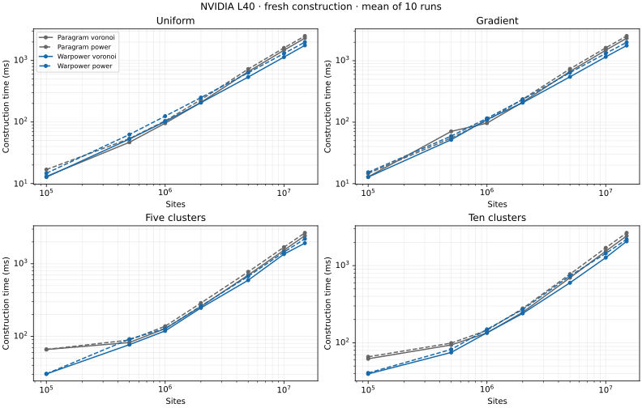
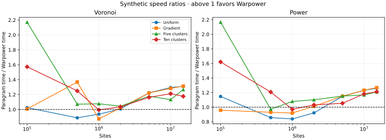
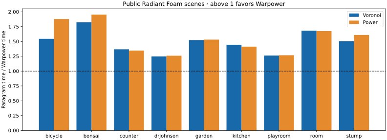

# NVIDIA L40 benchmark comparison

This matrix measures fresh **box-clipped Voronoi/power neighbor CSR construction**. It does not measure Delaunay tetrahedron construction or incremental updates. Rankings depend on workload and implementation; they cannot be chained with RadFoam update timings or paper results on different GPUs. See the [claim audit](../../experiments/benchmark-claims-audit/README.md) and [regression tracking issue](https://github.com/alecjacobson/warpower/issues/300).

Complete matrix: 74 paired cases; 0 missing. Geometric mean time ratio: 1.220×; Warpower is faster in 62 cases.

Synthetic: 1.141× geometric mean, faster in 44/56 cases. Real scenes: 1.504× geometric mean, faster in 18/18 cases.

The lowest time ratio is 0.838× on uniform 1,000,000-site power. The largest relative memory peak is 1.59× on cluster5 10,000,000-site voronoi: 27.20 GiB for Warpower versus 17.14 GiB for Paragram.

Ratios divide Paragram construction time by Warpower construction time; above 1 favors Warpower. Timings include allocation calls, hierarchy building, retries, and CSR output. Each case uses resident GPU inputs, three warm-ups, and ten measured calls. Warp retains 32 GiB in its allocator; PyTorch uses its normal cache. Every included measurement passed the CPU-throttling check. Exact package, driver, compiler, and chunking settings are in the [environment record](../environment-l40.json).

Status and adjacency statistics describe the final measured call. Failure counts exclude cells marked empty. A successful status does not prove geometric correctness. The methods and numerical limits are documented in [benchmark reproduction](../../docs/benchmarks.md) and [independent audits](../../docs/numerical-audit.md). Memory is an approximate device-wide NVML peak including contexts and allocator reserves.

A later exact facet audit of four scene checkpoints confirmed seven incorrect WarPower neighbor pairs (four spurious, three missing). The recorded timing wins therefore do not establish equally exact output. The claim audit links the separate checkpoint measurements and their correctness evidence; historical matrix timings below remain unchanged.

| Dataset | Sites | Mode | Paragram ms | Warpower ms | Ratio | Failed P / W | Empty P / W | Peak GiB P / W |
| --- | ---: | --- | ---: | ---: | ---: | ---: | ---: | ---: |
| bicycle | 4,199,873 | power | 1046.50 | 557.19 | 1.878× | 5712 / 0 | 928015 / 947960 | 13.01 / 15.12 |
| bicycle | 4,199,873 | voronoi | 760.84 | 492.49 | 1.545× | 1477 / 0 | 1 / 0 | 13.00 / 14.72 |
| bonsai | 1,968,522 | power | 525.94 | 269.37 | 1.953× | 3062 / 0 | 394951 / 405652 | 6.69 / 7.89 |
| bonsai | 1,968,522 | voronoi | 422.29 | 231.58 | 1.824× | 613 / 0 | 6 / 0 | 6.69 / 7.92 |
| cluster10 | 100,000 | power | 65.89 | 40.66 | 1.621× | 2 / 0 | 1059 / 1093 | 1.42 / 1.63 |
| cluster10 | 100,000 | voronoi | 62.13 | 39.51 | 1.572× | 1 / 0 | 0 / 0 | 1.42 / 1.63 |
| cluster10 | 500,000 | power | 99.11 | 82.10 | 1.207× | 27 / 0 | 5478 / 5678 | 2.53 / 2.91 |
| cluster10 | 500,000 | voronoi | 93.79 | 75.08 | 1.249× | 22 / 0 | 1 / 0 | 2.53 / 2.91 |
| cluster10 | 1,000,000 | power | 145.04 | 149.43 | 0.971× | 71 / 0 | 11000 / 11444 | 3.95 / 4.47 |
| cluster10 | 1,000,000 | voronoi | 134.41 | 135.21 | 0.994× | 53 / 0 | 2 / 0 | 3.95 / 4.47 |
| cluster10 | 2,000,000 | power | 278.73 | 270.38 | 1.031× | 170 / 0 | 21848 / 22696 | 6.77 / 7.57 |
| cluster10 | 2,000,000 | voronoi | 248.85 | 240.43 | 1.035× | 132 / 0 | 10 / 0 | 6.77 / 7.57 |
| cluster10 | 5,000,000 | power | 775.46 | 736.20 | 1.053× | 685 / 0 | 55139 / 57059 | 15.26 / 17.20 |
| cluster10 | 5,000,000 | voronoi | 697.35 | 599.83 | 1.163× | 527 / 0 | 43 / 0 | 15.25 / 17.16 |
| cluster10 | 10,000,000 | power | 1699.91 | 1438.04 | 1.182× | 1923 / 0 | 109565 / 113371 | 17.17 / 27.19 |
| cluster10 | 10,000,000 | voronoi | 1537.96 | 1269.63 | 1.211× | 1635 / 0 | 147 / 0 | 17.14 / 27.19 |
| cluster10 | 15,000,000 | power | 2658.22 | 2193.95 | 1.212× | 3591 / 0 | 164878 / 170220 | 25.19 / 28.59 |
| cluster10 | 15,000,000 | voronoi | 2428.66 | 2064.78 | 1.176× | 3088 / 0 | 266 / 0 | 25.13 / 28.17 |
| cluster5 | 100,000 | power | 66.08 | 30.51 | 2.166× | 6 / 0 | 1091 / 1129 | 1.42 / 1.63 |
| cluster5 | 100,000 | voronoi | 65.99 | 30.40 | 2.171× | 4 / 0 | 1 / 0 | 1.42 / 1.63 |
| cluster5 | 500,000 | power | 89.06 | 91.68 | 0.971× | 30 / 0 | 5475 / 5672 | 2.53 / 2.95 |
| cluster5 | 500,000 | voronoi | 82.41 | 76.96 | 1.071× | 18 / 0 | 3 / 0 | 2.53 / 2.88 |
| cluster5 | 1,000,000 | power | 138.15 | 128.08 | 1.079× | 80 / 0 | 10929 / 11299 | 3.95 / 4.44 |
| cluster5 | 1,000,000 | voronoi | 128.06 | 118.99 | 1.076× | 65 / 0 | 2 / 0 | 3.95 / 4.47 |
| cluster5 | 2,000,000 | power | 288.04 | 261.61 | 1.101× | 197 / 0 | 21981 / 22778 | 6.77 / 7.60 |
| cluster5 | 2,000,000 | voronoi | 257.98 | 247.04 | 1.044× | 183 / 0 | 11 / 0 | 6.77 / 7.64 |
| cluster5 | 5,000,000 | power | 773.95 | 671.81 | 1.152× | 873 / 0 | 54692 / 56624 | 15.26 / 17.16 |
| cluster5 | 5,000,000 | voronoi | 699.23 | 593.82 | 1.178× | 753 / 0 | 57 / 0 | 15.25 / 17.16 |
| cluster5 | 10,000,000 | power | 1690.36 | 1447.49 | 1.168× | 2619 / 0 | 109920 / 113568 | 17.17 / 27.19 |
| cluster5 | 10,000,000 | voronoi | 1537.38 | 1357.88 | 1.132× | 2248 / 0 | 166 / 0 | 17.14 / 27.20 |
| cluster5 | 15,000,000 | power | 2664.46 | 2203.74 | 1.209× | 4893 / 0 | 165012 / 170211 | 25.19 / 28.58 |
| cluster5 | 15,000,000 | voronoi | 2436.23 | 1922.85 | 1.267× | 4338 / 0 | 304 / 0 | 25.13 / 28.16 |
| counter | 1,985,308 | power | 355.46 | 264.13 | 1.346× | 992 / 0 | 82614 / 85449 | 6.73 / 7.95 |
| counter | 1,985,308 | voronoi | 324.81 | 237.52 | 1.368× | 588 / 0 | 3 / 0 | 6.73 / 7.98 |
| drjohnson | 2,847,252 | power | 462.51 | 367.26 | 1.259× | 1057 / 0 | 91517 / 94573 | 9.18 / 10.73 |
| drjohnson | 2,847,252 | voronoi | 423.04 | 339.41 | 1.246× | 751 / 0 | 9 / 0 | 9.17 / 10.73 |
| garden | 4,064,598 | power | 795.10 | 519.37 | 1.531× | 2714 / 0 | 290519 / 300820 | 12.61 / 14.42 |
| garden | 4,064,598 | voronoi | 705.22 | 462.93 | 1.523× | 1110 / 0 | 4 / 0 | 12.59 / 14.45 |
| gradient | 100,000 | power | 14.64 | 15.28 | 0.958× | 1 / 0 | 621 / 633 | 1.42 / 1.67 |
| gradient | 100,000 | voronoi | 12.88 | 12.79 | 1.007× | 0 / 0 | 0 / 0 | 1.42 / 1.63 |
| gradient | 500,000 | power | 55.23 | 59.42 | 0.930× | 2 / 0 | 3139 / 3210 | 2.53 / 2.95 |
| gradient | 500,000 | voronoi | 70.85 | 51.80 | 1.368× | 3 / 0 | 0 / 0 | 2.53 / 2.91 |
| gradient | 1,000,000 | power | 106.28 | 115.60 | 0.919× | 5 / 0 | 6314 / 6482 | 3.95 / 4.47 |
| gradient | 1,000,000 | voronoi | 96.52 | 110.60 | 0.873× | 6 / 0 | 0 / 0 | 3.95 / 4.52 |
| gradient | 2,000,000 | power | 236.26 | 233.62 | 1.011× | 15 / 0 | 12731 / 13059 | 6.77 / 7.60 |
| gradient | 2,000,000 | voronoi | 211.97 | 207.50 | 1.022× | 11 / 0 | 0 / 0 | 6.77 / 7.60 |
| gradient | 5,000,000 | power | 736.32 | 639.89 | 1.151× | 46 / 0 | 31271 / 32061 | 15.26 / 17.16 |
| gradient | 5,000,000 | voronoi | 669.02 | 547.48 | 1.222× | 19 / 0 | 0 / 0 | 15.25 / 17.16 |
| gradient | 10,000,000 | power | 1620.16 | 1314.14 | 1.233× | 73 / 0 | 63000 / 64672 | 17.17 / 27.19 |
| gradient | 10,000,000 | voronoi | 1483.13 | 1156.46 | 1.282× | 65 / 0 | 0 / 0 | 17.14 / 27.19 |
| gradient | 15,000,000 | power | 2526.50 | 1991.75 | 1.268× | 159 / 0 | 94307 / 96908 | 25.19 / 28.16 |
| gradient | 15,000,000 | voronoi | 2320.63 | 1766.45 | 1.314× | 99 / 0 | 0 / 0 | 25.13 / 28.16 |
| kitchen | 2,045,196 | power | 379.52 | 268.72 | 1.412× | 936 / 0 | 42390 / 43572 | 6.89 / 7.72 |
| kitchen | 2,045,196 | voronoi | 354.19 | 245.37 | 1.444× | 717 / 0 | 2 / 0 | 6.89 / 7.72 |
| playroom | 3,181,453 | power | 513.25 | 405.07 | 1.267× | 1178 / 0 | 127981 / 132640 | 10.13 / 11.81 |
| playroom | 3,181,453 | voronoi | 466.73 | 369.84 | 1.262× | 611 / 0 | 1 / 0 | 10.12 / 11.76 |
| room | 1,888,510 | power | 395.84 | 236.40 | 1.674× | 886 / 0 | 82650 / 85476 | 6.46 / 7.26 |
| room | 1,888,510 | voronoi | 363.35 | 216.13 | 1.681× | 524 / 0 | 2 / 0 | 6.46 / 7.26 |
| stump | 4,186,146 | power | 908.25 | 564.23 | 1.610× | 4701 / 0 | 612406 / 632116 | 12.97 / 14.80 |
| stump | 4,186,146 | voronoi | 738.03 | 490.54 | 1.505× | 1034 / 0 | 0 / 0 | 12.95 / 14.44 |
| uniform | 100,000 | power | 16.86 | 14.70 | 1.147× | 0 / 0 | 524 / 544 | 1.42 / 1.67 |
| uniform | 100,000 | voronoi | 13.04 | 12.73 | 1.024× | 0 / 0 | 0 / 0 | 1.42 / 1.63 |
| uniform | 500,000 | power | 53.62 | 62.61 | 0.857× | 6 / 0 | 2575 / 2638 | 2.53 / 2.95 |
| uniform | 500,000 | voronoi | 46.91 | 52.81 | 0.888× | 4 / 0 | 0 / 0 | 2.53 / 2.91 |
| uniform | 1,000,000 | power | 104.44 | 124.60 | 0.838× | 5 / 0 | 5160 / 5260 | 3.95 / 4.52 |
| uniform | 1,000,000 | voronoi | 95.60 | 102.01 | 0.937× | 5 / 0 | 0 / 0 | 3.95 / 4.47 |
| uniform | 2,000,000 | power | 230.19 | 249.72 | 0.922× | 11 / 0 | 10539 / 10768 | 6.77 / 7.64 |
| uniform | 2,000,000 | voronoi | 208.17 | 206.80 | 1.007× | 6 / 0 | 0 / 0 | 6.77 / 7.60 |
| uniform | 5,000,000 | power | 725.58 | 631.81 | 1.148× | 43 / 0 | 25945 / 26567 | 15.26 / 17.16 |
| uniform | 5,000,000 | voronoi | 658.89 | 538.58 | 1.223× | 33 / 0 | 1 / 0 | 15.25 / 17.16 |
| uniform | 10,000,000 | power | 1603.00 | 1301.43 | 1.232× | 67 / 0 | 51941 / 53227 | 17.17 / 27.19 |
| uniform | 10,000,000 | voronoi | 1471.13 | 1136.96 | 1.294× | 48 / 0 | 0 / 0 | 17.14 / 27.19 |
| uniform | 15,000,000 | power | 2505.68 | 1989.11 | 1.260× | 137 / 0 | 77967 / 79894 | 25.19 / 28.16 |
| uniform | 15,000,000 | voronoi | 2312.00 | 1765.28 | 1.310× | 72 / 0 | 0 / 0 | 25.13 / 28.16 |
